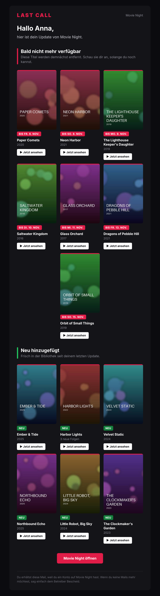
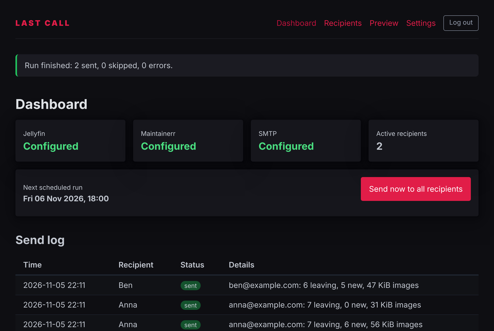
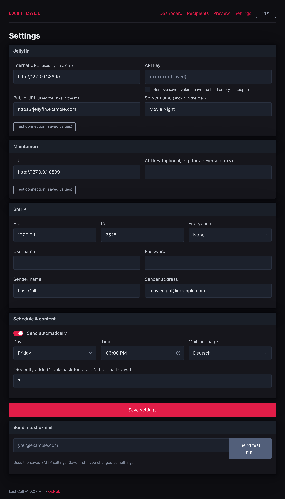
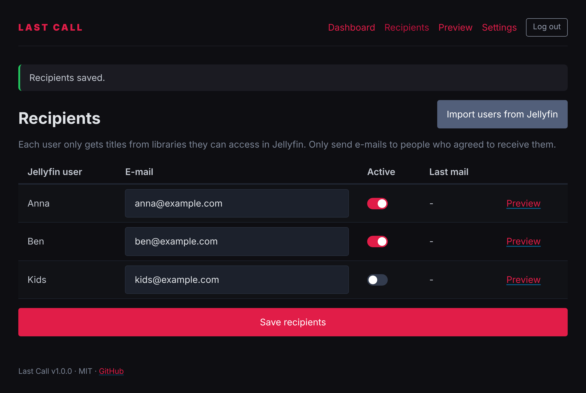
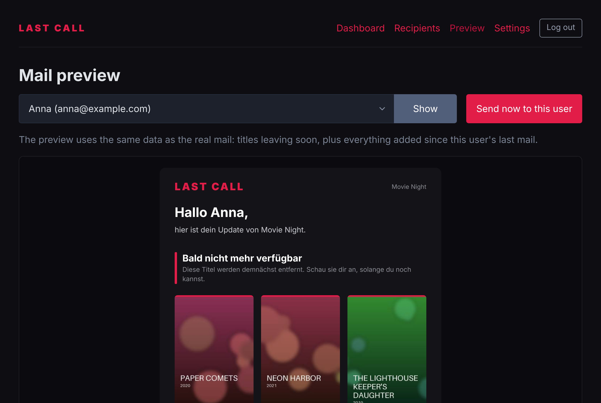
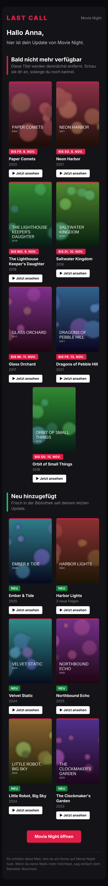

<div align="center">

# Last Call

**E-mail your Jellyfin users what is leaving soon (via Maintainerr) and what is new, styled like a streaming service's newsletter.**

[](https://github.com/flowoy96/last-call/actions/workflows/docker.yml)
[](LICENSE)


**🇩🇪 [Deutsch](#deutsch)** · **🇬🇧 [English](#english)**



</div>

---

## Deutsch

### Was ist Last Call?

Last Call ist eine kleine, selbstgehostete Web-App. Sie schickt deinen Jellyfin-Nutzerinnen und -Nutzern regelmäßig eine E-Mail mit:

- **Bald nicht mehr verfügbar**: Titel aus deinen Maintainerr-Collections mit dem berechneten Löschdatum (Datum der Aufnahme in die Collection + „Take action after days“).
- **Neu hinzugefügt**: Filme, Serien und neue Folgen seit der letzten Mail.

Jede Person bekommt nur Titel aus Bibliotheken, auf die sie in Jellyfin Zugriff hat. Leere Abschnitte fallen weg, und ganz leere Mails werden gar nicht erst verschickt.

### Funktionen

- Ein einziger Container (Python, Starlette, SQLite). Kein Datenbank-Container und kein JavaScript-Framework. Image für `amd64` und `arm64`.
- Einrichtung komplett im Web-UI, keine Secrets in Umgebungsvariablen nötig. API-Keys und Passwörter werden maskiert angezeigt.
- Empfänger per Klick aus Jellyfin importieren, E-Mail-Adresse pro Person hinterlegen und einzeln aktivieren.
- Dunkles Mail-Design im Streaming-Look: Poster-Raster, Löschdatum als Badge, „Jetzt ansehen“-Deep-Links in Jellyfin. Tabellen-Layout mit Inline-CSS, responsiv, mit Outlook-Fallbacks.
- Poster werden verkleinert (ca. 5 KB pro Bild) und als CID-Anhang eingebettet. Jellyfin muss dafür nicht öffentlich erreichbar sein.
- Zeitplan (täglich oder wöchentlich, Uhrzeit frei wählbar), Mails auf Deutsch oder Englisch.
- Vorschau pro Person im Browser, „Jetzt senden“, Testmail, Verbindungstests und ein Versandprotokoll.
- Sicherheit: Admin-Login mit scrypt-Hash, CSRF-Schutz, Login-Rate-Limit, Security-Header, Container läuft als Non-Root.

### Screenshots

| Dashboard | Einstellungen |
|---|---|
|  |  |
| **Empfänger** | **Mail-Vorschau** |
|  |  |

<details><summary>Mail auf dem Smartphone</summary>

</details>

> Alle Titel und Poster in den Screenshots sind frei erfunden und automatisch generiert.

### Quickstart mit Portainer

1. In Portainer **Stacks → Add stack → Web editor** öffnen.
2. Diesen Stack einfügen und **Deploy the stack** klicken:

```yaml
services:
  last-call:
    image: ghcr.io/flowoy96/last-call:latest
    container_name: last-call
    restart: unless-stopped
    ports:
      - "8080:8080"
    environment:
      - TZ=Europe/Berlin
      - LASTCALL_SECURE_COOKIES=0
    volumes:
      - last-call-data:/data
    healthcheck:
      test: ["CMD", "wget", "-qO-", "http://127.0.0.1:8080/health"]
      interval: 30s
      timeout: 5s
      retries: 3
      start_period: 10s

volumes:
  last-call-data:
```

3. `http://<host>:8080` öffnen und den Admin-Account anlegen.
4. Unter **Settings** Jellyfin, Maintainerr und SMTP eintragen, speichern und mit den Test-Buttons prüfen.
5. Unter **Recipients** auf **Import users from Jellyfin** klicken, E-Mail-Adressen eintragen und Empfänger aktivieren.
6. Unter **Preview** die Mail ansehen und bei Bedarf sofort senden.

Ohne Docker Compose geht es auch so:

```bash
docker run -d --name last-call -p 8080:8080 -e TZ=Europe/Berlin -v last-call-data:/data --restart unless-stopped ghcr.io/flowoy96/last-call:latest
```

### Konfiguration

Alles Wesentliche wird im Web-UI eingestellt und in `/data/lastcall.db` (SQLite) gespeichert.

| Einstellung | Hinweis |
|---|---|
| Jellyfin-URL (intern) | Adresse, unter der Last Call Jellyfin erreicht, z. B. `http://jellyfin:8096` |
| Jellyfin-API-Key | Jellyfin → Dashboard → API-Schlüssel → `+` |
| Öffentliche Jellyfin-URL | Wird für die Links in der Mail verwendet, z. B. `https://jellyfin.example.com` |
| Maintainerr-URL | z. B. `http://maintainerr:6246`. Maintainerr hat selbst keine API-Authentifizierung. Das optionale API-Key-Feld wird als `X-Api-Key`-Header mitgeschickt, etwa für einen Reverse Proxy. |
| SMTP | Host, Port, STARTTLS/SSL/keine, Benutzer, Passwort, Absendername und -adresse |
| Zeitplan | Täglich oder an einem Wochentag zu einer festen Uhrzeit (Zeitzone aus `TZ`) |

Umgebungsvariablen (alle optional):

| Variable | Standard | Bedeutung |
|---|---|---|
| `TZ` | `Europe/Berlin` | Zeitzone für Zeitplan und Löschdaten |
| `LASTCALL_SECURE_COOKIES` | `0` | Auf `1` setzen, wenn Last Call nur per HTTPS erreichbar ist |
| `FORWARDED_ALLOW_IPS` | `127.0.0.1` | IP deines Reverse Proxys, damit Last Call die echte Client-IP (für das Login-Rate-Limit) sieht |
| `LOG_LEVEL` | `INFO` | Log-Level |

**So wird das Löschdatum berechnet:** Für jede aktive Maintainerr-Collection mit einer Aktion, die Dateien entfernt (*Delete*, *Unmonitor and delete*, *Delete show if empty*), und mit gesetztem *Take action after days* gilt: Datum der Aufnahme in die Collection + Tage. Steht ein Titel in mehreren Collections, gilt das früheste Datum. Collections mit *Do nothing*, *Unmonitor* oder *Change quality profile* werden ignoriert.

**„Neu hinzugefügt“** umfasst alles seit der letzten erfolgreich versendeten Mail an diese Person. Bei der ersten Mail wird so viele Tage zurückgeschaut, wie in den Einstellungen festgelegt ist (Standard: 7).

### Update

In Portainer den Stack öffnen und **Pull and redeploy** wählen, bzw. per CLI:

```bash
docker compose pull && docker compose up -d
```

Die Daten im Volume `/data` bleiben dabei erhalten.

### FAQ

**Muss Jellyfin öffentlich erreichbar sein?**
Nein. Poster werden eingebettet. Nur die „Jetzt ansehen“-Links zeigen auf die öffentliche URL. Ohne öffentliche URL funktionieren sie nur im Heimnetz.

**Löscht Last Call etwas?**
Nein. Last Call liest nur. Gelöscht wird ausschließlich von Maintainerr.

**Gibt es OIDC/SSO (z. B. Authentik)?**
Nicht eingebaut, um die App schlank zu halten. Stell Last Call hinter deinen Reverse Proxy mit Forward Auth (Authentik-Proxy-Provider, Authelia …). Der eingebaute Admin-Login bleibt zusätzlich aktiv.

**Warum ist die Weboberfläche englisch?**
Damit der Code klein bleibt. Die E-Mails gibt es auf Deutsch und Englisch.

**Ich nutze einen Bind-Mount statt eines Volumes und bekomme „permission denied“.**
Der Container läuft als UID/GID `1000`. Setze die Rechte entsprechend: `chown -R 1000:1000 /pfad/zu/data`.

**Wie groß werden die Mails?**
Ein Poster ist etwa 4–6 KB groß. Eine Mail mit 30 Titeln hat also rund 150–200 KB.

**Wird die Mail in Gmail, Outlook und Apple Mail richtig dargestellt?**
Das Template verwendet die üblichen E-Mail-Techniken: Tabellen, Inline-Styles, Fluid-Hybrid-Raster, MSO-Conditional-Comments und einen VML-Button. Falls in deinem Client etwas komisch aussieht, eröffne bitte ein Issue mit Screenshot.

### Lizenz und Haftungsausschluss

[MIT](LICENSE). Die Software wird „wie besehen“ ohne Gewährleistung bereitgestellt, die Nutzung erfolgt auf eigenes Risiko. Es gibt keine Haftung für Schäden, Datenverlust oder versehentliche Löschungen. Dieses Projekt ist nicht mit Jellyfin, Maintainerr oder anderen genannten Projekten verbunden und wird von ihnen nicht unterstützt. Marken gehören ihren Inhabern. Last Call stellt keine Medieninhalte bereit und ist nicht für die Verbreitung urheberrechtlich geschützter Inhalte gedacht. Du bist selbst für die Rechtmäßigkeit deiner Mediathek verantwortlich. Als Betreiberin oder Betreiber bist du außerdem selbst für den Datenschutz (DSGVO) beim Speichern von E-Mail-Adressen und beim Versand verantwortlich, einschließlich der Einwilligung der Empfängerinnen und Empfänger. Details stehen in [DISCLAIMER.md](DISCLAIMER.md).

---

## English

### What is Last Call?

Last Call is a small self-hosted web app. It periodically e-mails your Jellyfin users:

- **Leaving soon**: titles from your Maintainerr collections with their calculated removal date (date added to the collection + "take action after days").
- **Recently added**: movies, shows and new episodes since their last e-mail.

Each user only sees titles from libraries they can access in Jellyfin. Empty sections are left out, and completely empty e-mails are never sent.

### Features

- One container (Python, Starlette, SQLite). No database container and no JavaScript framework. `amd64` and `arm64` images.
- Configured entirely in the web UI, so no secrets are needed in environment variables. API keys and passwords are masked.
- Import recipients from Jellyfin with one click, add an e-mail address per user and enable each one individually.
- Dark, streaming-style e-mail: poster grid, removal date badge, "Watch now" deep links into Jellyfin. Table layout with inline CSS, responsive, with Outlook fallbacks.
- Posters are resized (around 5 KB each) and embedded as CID attachments, so Jellyfin does not need to be publicly reachable.
- Schedule (daily or weekly at a time you choose), e-mails in German or English.
- Per-user preview in the browser, "send now", test e-mail, connection tests and a send log.
- Security: admin login with scrypt hash, CSRF protection, login rate limit, security headers, non-root container.

### Screenshots

See the [screenshots above](#screenshots). All titles and posters shown are made up and generated automatically.

### Quickstart with Portainer

1. In Portainer go to **Stacks → Add stack → Web editor**.
2. Paste [`docker-compose.yml`](docker-compose.yml) (same content as in the German section) and click **Deploy the stack**.
3. Open `http://<host>:8080` and create the admin account.
4. In **Settings**, enter Jellyfin, Maintainerr and SMTP, save, and use the test buttons.
5. In **Recipients**, click **Import users from Jellyfin**, add e-mail addresses and enable recipients.
6. In **Preview**, check the e-mail and send it right away if you like.

### Configuration

Everything is configured in the web UI and stored in `/data/lastcall.db` (SQLite).

| Setting | Notes |
|---|---|
| Jellyfin URL (internal) | How Last Call reaches Jellyfin, e.g. `http://jellyfin:8096` |
| Jellyfin API key | Jellyfin → Dashboard → API Keys → `+` |
| Public Jellyfin URL | Used for links in the e-mail, e.g. `https://jellyfin.example.com` |
| Maintainerr URL | e.g. `http://maintainerr:6246`. Maintainerr has no API authentication of its own. The optional API key is sent as an `X-Api-Key` header, e.g. for a reverse proxy. |
| SMTP | Host, port, STARTTLS/SSL/none, user, password, sender name and address |
| Schedule | Daily or on one weekday at a fixed time (time zone from `TZ`) |

Environment variables (all optional):

| Variable | Default | Meaning |
|---|---|---|
| `TZ` | `Europe/Berlin` | Time zone for the schedule and removal dates |
| `LASTCALL_SECURE_COOKIES` | `0` | Set to `1` if Last Call is only served over HTTPS |
| `FORWARDED_ALLOW_IPS` | `127.0.0.1` | Your reverse proxy's IP, so the real client IP is used for the login rate limit |
| `LOG_LEVEL` | `INFO` | Log level |

**How the removal date is calculated:** for every active Maintainerr collection whose action removes files (*Delete*, *Unmonitor and delete*, *Delete show if empty*) and that has *take action after days* set, the date is: date added to the collection + days. If a title is in several collections, the earliest date wins. Collections with *Do nothing*, *Unmonitor* or *Change quality profile* are ignored.

**"Recently added"** covers everything since the last e-mail successfully sent to that user. For their first e-mail, Last Call looks back the number of days configured in the settings (default: 7).

### Updating

In Portainer open the stack and choose **Pull and redeploy**, or run:

```bash
docker compose pull && docker compose up -d
```

Your data in the `/data` volume is kept.

### FAQ

**Does Jellyfin need to be publicly reachable?**
No. Posters are embedded. Only the "Watch now" links point to the public URL. Without one, they only work inside your home network.

**Does Last Call delete anything?**
No. It only reads data. Deleting is done exclusively by Maintainerr.

**OIDC/SSO (e.g. Authentik)?**
Not built in, to keep the app small. Put Last Call behind your reverse proxy with forward auth (Authentik proxy provider, Authelia, …). The built-in admin login stays active as well.

**Why is the web UI in English?**
To keep the code small. The e-mails are available in German and English.

**I use a bind mount and get "permission denied".**
The container runs as UID/GID `1000`: `chown -R 1000:1000 /path/to/data`.

**How big are the e-mails?**
About 4–6 KB per poster, so an e-mail with 30 titles is roughly 150–200 KB.

**Does the e-mail render correctly in Gmail, Outlook and Apple Mail?**
The template uses the usual e-mail techniques: tables, inline styles, a fluid-hybrid grid, MSO conditional comments and a VML button. If something looks off in your client, please open an issue with a screenshot.

### License and disclaimer

[MIT](LICENSE). The software is provided "as is", without warranty of any kind, and you use it at your own risk. There is no liability for damages, data loss or accidental deletions. This project is not affiliated with or endorsed by Jellyfin, Maintainerr or any other project mentioned. Trademarks belong to their owners. Last Call provides no media content and is not intended for distributing copyrighted material. You are responsible for the legality of your media library. As an operator, you are also responsible for data protection (GDPR) when storing e-mail addresses and sending e-mails, including obtaining your recipients' consent. See [DISCLAIMER.md](DISCLAIMER.md).

Third-party: [Pico CSS](https://picocss.com) (MIT) is bundled in `app/static/`.
